# Option A: one staff web app

One web app for staff, five backend services and one Kafka broker. All sales happen at the POS screen, run by a cashier. Customers do not use the system.

> **Status (2026-11-22):** the team has chosen this option. Revised after the architecture review: Kafka replaces RabbitMQ, APScheduler replaces Celery, and six gaps found in review are fixed (see [section 14](#14-changes-from-the-architecture-review)). [Section 13.2](#132-demo-priority) lists what must work in the demo and what is deferred.

- [1. Scope](#1-scope)
- [2. Architecture overview](#2-architecture-overview)
- [3. Tech stack](#3-tech-stack)
- [4. Services](#4-services)
- [5. Database design](#5-database-design)
- [6. Communication matrix](#6-communication-matrix)
- [7. Key flows](#7-key-flows)
- [8. Data pipeline and aggregation](#8-data-pipeline-and-aggregation)
- [9. Reporting and forecasting](#9-reporting-and-forecasting)
- [10. Front end](#10-front-end)
- [11. Failure handling and design rationale](#11-failure-handling-and-design-rationale)
- [12. Deployment](#12-deployment)
- [13. Team split and build order](#13-team-split-and-build-order)
- [14. Changes from the architecture review](#14-changes-from-the-architecture-review)

---

## 1. Scope

**In scope**

| Requirement (from the brief) | Covered by |
|---|---|
| Shop and branch administration | Admin service, HQ screens |
| Customer orders | POS sales and whole-order refunds (Order service) |
| Products and inventory | Catalog and Inventory services |
| Daily and monthly sales reporting | Analytics: reporting module |
| Cross-branch comparison | Analytics: reporting module |
| Sales forecasting | Analytics: forecasting module |
| Stock replenishment recommendations | Analytics: replenishment module, approved by managers |
| AI explanations for managers (added) | Analytics: insights module. A local LLM (Ollama) writes the morning briefing and explains each recommendation. |

**Out of scope:** customer accounts and online ordering (see Option B), real payment processing, tax, discounts, partial refunds, the POS offline queue, multiple timezones and currencies.

---

## 2. Architecture overview

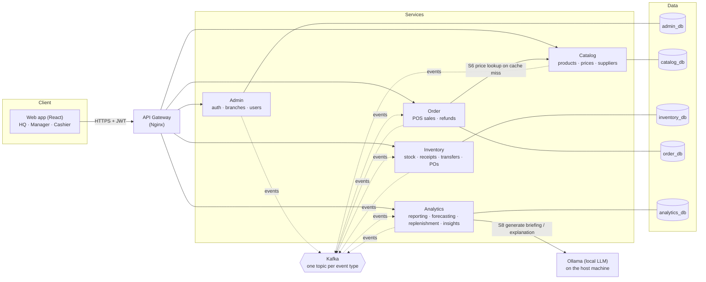

Solid arrows are synchronous REST calls. Dotted arrows are asynchronous events. Each service reads and writes only its own database.

**Principles**

1. **One owner per piece of data.** Other services hold an ID, a snapshot, or an event-fed read-only copy.
2. **The till depends on one service.** The POS screen talks only to Order, which keeps local copies of products and prices. A Catalog or Inventory outage does not stop sales.
3. **Events for facts, REST for questions.** A finished sale is announced as an event. A screen that needs an answer now calls REST.
4. **Reports never touch operational databases.** Analytics builds its own tables from events.

---

## 3. Tech stack

| Concern | Choice | Notes |
|---|---|---|
| Services | Python 3.12, Django 5 + Django REST Framework | Matches the existing Django system; the team already knows it |
| Front end | React + Vite + TypeScript, React Router, Mantine (UI kit), TanStack Query, Recharts | One app; routes grouped by role. A UI kit is needed to build three role areas in time. |
| Gateway | Nginx | Path routing, CORS, rate limiting. JWTs are verified in each service. In development, the Vite dev proxy plays this role. |
| Auth | Admin service issues RS256 JWTs (PyJWT); every service gets the public key from an env var | No Keycloak, no JWKS fetching |
| Databases | One PostgreSQL 16 server, **one database and one DB user per service** | The init script runs `REVOKE CONNECT ... FROM PUBLIC` on every database, so a service's user can connect only to its own (see [5.6](#56-how-services-reference-each-others-data)) |
| Messaging | Apache Kafka 4.x, **single broker in KRaft mode** (no ZooKeeper), one topic per event type, one consumer group per consuming service. Client: `confluent-kafka` | `kafka-ui` container to show topics and messages during the demo |
| Scheduled jobs | APScheduler, in a dedicated `analytics-scheduler` process | The nightly jobs run in sequence in one Python function, so Celery isn't needed. HQ can also trigger any job on demand. |
| Forecasting | pandas + statsmodels | |
| LLM | **Ollama**, running on the host machine, called over its HTTP API (`/api/chat`) with structured JSON output. Default model `gemma4:12b`, overridable with `OLLAMA_MODEL` | The LLM only writes text about numbers the system already computed. `LLM_PROVIDER=fake` returns canned text for teammates without Ollama. |
| Packaging | Docker Compose, **one monorepo** | One `docker compose up` runs everything. Each image installs `retail-common` from the repo with `pip install`. |

**Shared library `retail-common`** (owned by member 2), used by every service:

- `verify_jwt()` and a DRF permission class `HasRole("BRANCH_MANAGER", branch_from="branch_id")`
- `Outbox` model + `run_relay` command: publishes unsent outbox rows to Kafka in `created_at` order, with `acks=all` and an idempotent producer, then sets `published_at`
- `ProcessedEvent` model + `@idempotent_consumer` decorator
- `run_consumer` command: subscribes a consumer group to its topics, applies each message in one DB transaction, and **commits the Kafka offset only after that transaction commits**. After 3 failed attempts the message goes to `<topic>.dlq` with the error in its headers, and the offset is committed.
- The event envelope dataclass and the topic catalogue (names, keys, cleanup policy)

---

## 4. Services

### 4.1 Admin

| | |
|---|---|
| **Purpose** | Who works for the company, where, and with what rights. Issues login tokens. |
| **Owns** | shop, branch, user, role grant |
| **Not its job** | stock or sales of a branch. It only says the branch exists. |
| **Merged from full design** | Identity & Access + Branch. Merging them means a role grant can have a real foreign key to `branch`. |
| **Key API** | `POST /auth/login`, `GET /.well-known/jwks.json`, `GET/POST/PATCH /branches`, `GET/POST/PATCH /users`, `POST /users/{id}/roles`, `DELETE /users/{id}/roles/{grant_id}` |
| **Publishes** | `branch.upserted` |
| **Consumes** | nothing |

JWT claims: `sub` (user_id), `name`, `roles: [{"role": "BRANCH_MANAGER", "branch_id": "BR-04"}, {"role": "HQ_ADMIN", "branch_id": null}]`, `exp` (8 hours). Roles: `HQ_ADMIN`, `BRANCH_MANAGER`, `CASHIER`.

### 4.2 Catalog

| | |
|---|---|
| **Purpose** | What the company sells, at what price, and who supplies it. |
| **Owns** | category, product, SKU, price (base and per-branch), supplier, supplier terms |
| **Not its job** | quantities on hand |
| **Key API** | `GET /products?q=&category_id=`, `GET /skus/{sku}`, `POST/PATCH /products`, `PUT /prices/{sku}` (body: `branch_scope`, `amount`, `valid_from`), `GET /prices/{sku}?branch_id=`, `GET/POST/PATCH /suppliers`, `PUT /suppliers/{id}/skus/{sku}` |
| **Publishes** | `product.upserted`, `price.changed`, `supplier_terms.changed` |
| **Consumes** | nothing |

### 4.3 Inventory

| | |
|---|---|
| **Purpose** | How many units of each SKU are in each branch, and why that number changed. |
| **Owns** | stock level, movement ledger, goods receipt, inter-branch transfer, purchase order |
| **Not its job** | deciding what to reorder (Analytics) or prices (Catalog) |
| **Key API** | `GET /stock?branch_id=&sku=&low_only=`, `GET /stock/{branch_id}/{sku}/movements`, `POST /adjustments`, `GET /purchase-orders?branch_id=&status=`, `POST /receipts` (against a PO or ad hoc), `GET/POST /transfers`, `POST /transfers/{id}/ship`, `POST /transfers/{id}/receive` |
| **Publishes** | `stock.adjusted` |
| **Consumes** | `branch.upserted`, `product.upserted`, `order.completed`, `order.refunded`, `replenishment.approved` |

Every change to `stock_level` writes one `stock_movement` row in the same transaction, so stock can always be recomputed from the ledger.

### 4.4 Order

| | |
|---|---|
| **Purpose** | Record POS sales and refunds. Serve the POS screen. |
| **Owns** | sales order, order lines with price snapshots, payments, local product and price copies |
| **Not its job** | stock levels, report totals |
| **Key API** | `GET /pos/items?barcode=` or `?q=` (served from local copies), `POST /orders`, `GET /orders?branch_id=&date=`, `GET /orders/{id}`, `POST /orders/{id}/refund`, internal: `GET /internal/sales-summary?date=` |
| **Publishes** | `order.completed`, `order.refunded` |
| **Consumes** | `product.upserted`, `price.changed` |

`POST /orders` body:

```json
{
  "order_id": "6f1c…",            // generated by the browser; a retry with the same id returns the first result
  "branch_id": "BR-04",
  "lines": [{"sku": "COKE-330", "qty": 2}, {"sku": "BREAD-WHT", "qty": 1}],
  "payments": [{"method": "CASH", "amount": 3.40}]
}
```

Order looks up each SKU's price itself. It never trusts a price sent by the browser. If a price is missing from `price_cache`, it calls Catalog (S6).

### 4.5 Analytics

| | |
|---|---|
| **Purpose** | Turn sales and stock events into reports, forecasts, anomaly alerts, reorder suggestions and LLM-written briefings. |
| **Owns** | the reporting star schema, forecasts, anomalies, stock policies, recommendations, manager decisions |
| **Not its job** | writing to any operational database or changing stock directly |
| **Merged from full design** | Reporting + Forecasting + Replenishment, as three Django apps in one service, plus a fourth app, **Insights**, for the LLM features. They share data and the nightly schedule, and one team member owns them. They can be split later along those app boundaries. |
| **Key API** | `GET /reports/sales?scope=branch|company&branch_id=&grain=day|month&from=&to=`, `GET /reports/branches/compare?month=`, `GET /reports/top-skus?branch_id=&from=&to=`, `GET /forecasts?branch_id=&sku=`, `GET /anomalies?branch_id=&status=`, `PATCH /anomalies/{id}`, `GET /recommendations?branch_id=&status=PENDING`, `POST /recommendations/{id}/decision`, `GET/PUT /stock-policies`, `POST /jobs/{job}/run` and `GET /jobs/runs` (HQ only; runs J1–J7 on demand), `GET /briefings?branch_id=&date=`, `POST /recommendations/{id}/explain` |
| **Publishes** | `replenishment.approved` |
| **Consumes** | `branch.upserted`, `product.upserted`, `supplier_terms.changed`, `order.completed`, `order.refunded`, `stock.adjusted` |

### What stays together, what is split

| Decision | Reason |
|---|---|
| Identity + Branch → **Admin** | Both are low-traffic HQ admin data. Merging gives a real FK from role grant to branch and removes Keycloak. |
| Payments inside **Order** | Payment is only a recorded method and amount; it changes with the order. |
| Reporting + Forecasting + Replenishment → **Analytics** | All three read the same sales facts on the same nightly schedule. Split later if separate teams form. |
| Catalog vs Inventory **split** | Catalog is read-mostly and edited by HQ. Inventory is written on every sale line and needs row locking. |
| Order vs Inventory **split** | A sale must succeed even when stock data is wrong or Inventory is down. Stock is corrected by events afterwards. |

---

## 5. Database design

Every database that publishes events has an `outbox` table. Every database that consumes events has a `processed_event` table:

```
outbox          (event_id uuid PK, event_type, routing_key, payload jsonb, created_at, published_at null)
processed_event (event_id uuid PK, event_type, processed_at)
```

The business change and its outbox row are written in **one transaction**, so an event is never lost and never sent for a change that rolled back. A consumer inserts into `processed_event` in the same transaction as its own change, and commits its Kafka offset only afterwards. If it crashes in between, Kafka redelivers the event, which hits the `processed_event` primary key and is skipped. Delivery is at-least-once, and processing is effectively once.

Published outbox rows can be deleted after 7 days. Replay comes from Kafka's retained log, not from the outbox.

### 5.1 admin_db

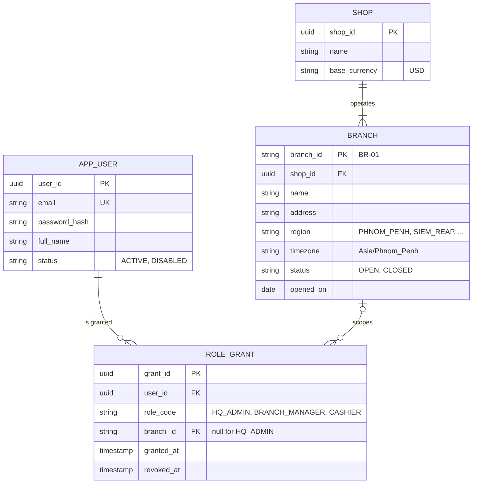

Closing a branch sets `branch.status = CLOSED`, revokes its role grants and publishes `branch.upserted`. Branches are never deleted.

### 5.2 catalog_db

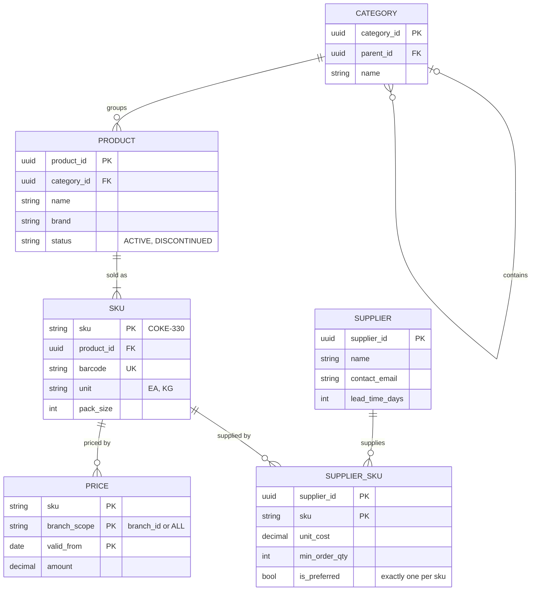

Price rule: for a SKU at a branch on a date, take the latest `valid_from <= date` with `branch_scope = branch_id`. If there is none, use the latest with `branch_scope = 'ALL'`.

### 5.3 inventory_db

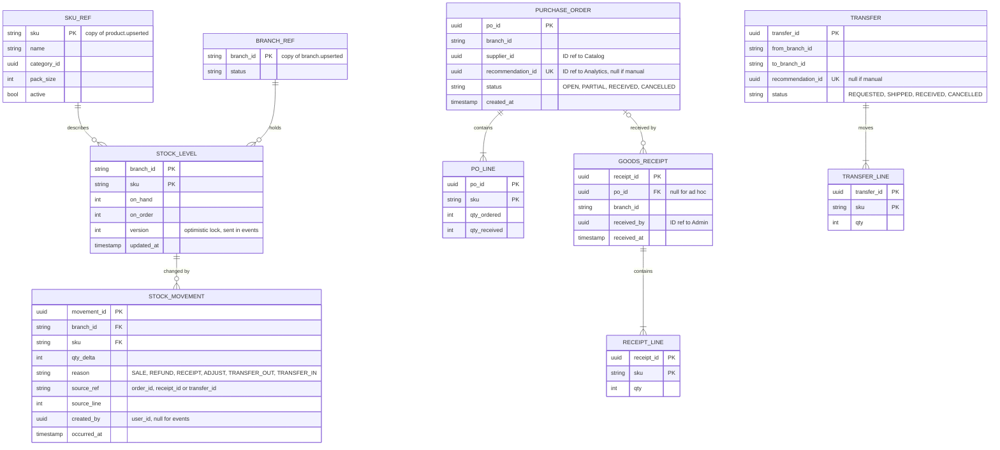

- `stock_movement` has `UNIQUE (source_ref, source_line, branch_id, reason)`. Even if idempotency failed, the same sale line could not be deducted twice.
- `on_hand` may go negative. The goods were physically sold, so the system must accept the sale and show the discrepancy. Negative stock is listed on the manager's stock screen for a count adjustment.
- `on_order` rises when a PO is created and falls when it is received.

### 5.4 order_db

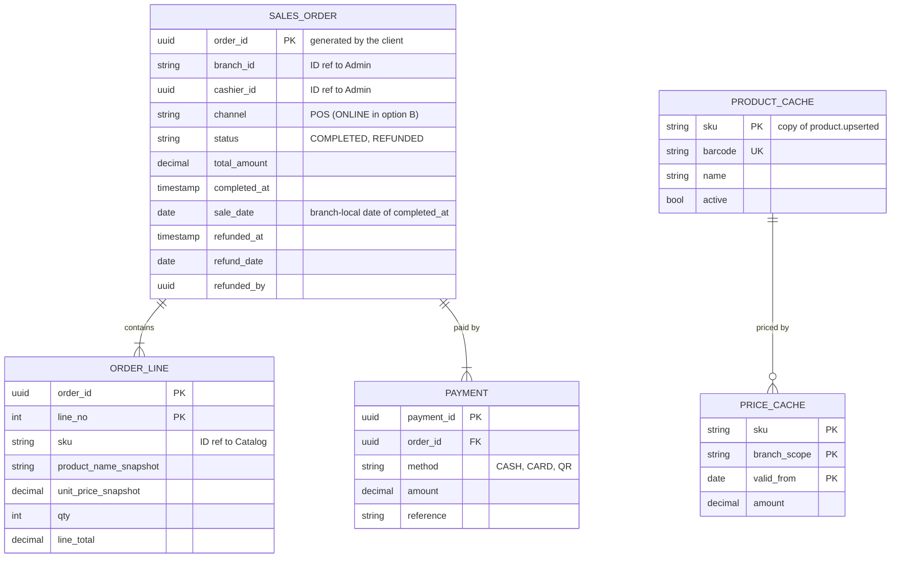

`order_line` keeps the name and price **at the time of sale**, so an old receipt stays correct after a price change.

### 5.5 analytics_db

One database with four schemas. Each schema belongs to one internal module.

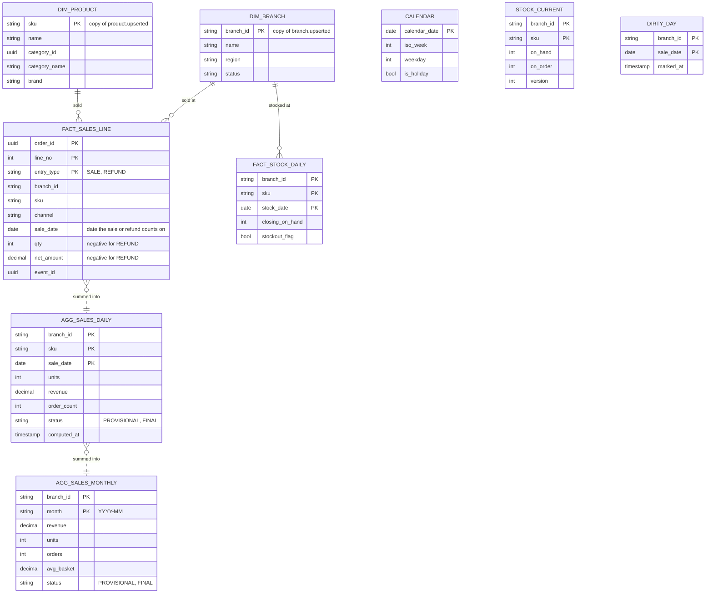

Reporting schema above. Forecasting and replenishment schemas:

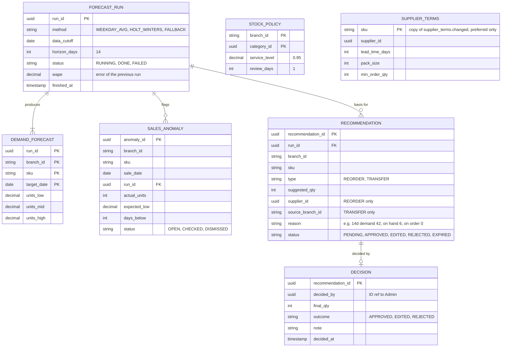

Insights schema (LLM output):

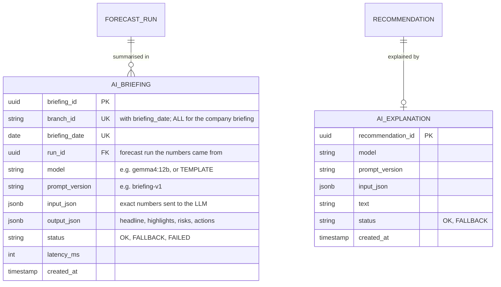

`input_json` keeps the exact numbers the LLM was given, so every sentence can be checked against its source.

### 5.6 How services reference each other's data

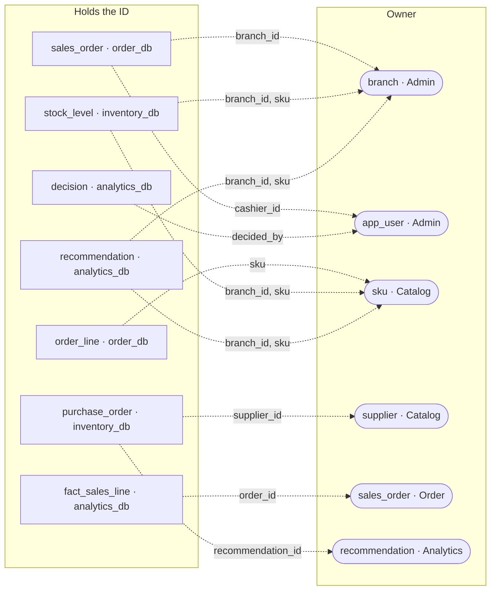

| Pattern | Use it when | Example |
|---|---|---|
| **Reference by ID** | Always, for any cross-service link. No foreign key. | `sales_order.branch_id = "BR-04"` |
| **Snapshot** | The value must not change after the record is created | `order_line.unit_price_snapshot` |
| **Event-fed local copy** | The value is read often and can be seconds stale | `product_cache`, `price_cache`, `sku_ref`, `dim_branch`, `stock_current` |
| **Synchronous call to the owner** | A write needs data the copy doesn't have yet | Order → Catalog `GET /prices/{sku}` on a cache miss |
| **Never hard-delete** | A shared ID is retired | `branch.status = CLOSED`, `product.status = DISCONTINUED` |

**How cross-database access is prevented:** each service connects with its own PostgreSQL user, which has `CONNECT` only on its own database. PostgreSQL grants `CONNECT` to `PUBLIC` by default, so the init script removes that first:

```sql
REVOKE CONNECT ON DATABASE order_db FROM PUBLIC;
GRANT  CONNECT ON DATABASE order_db TO order_svc;
-- repeated for admin_db, catalog_db, inventory_db, analytics_db
```

A connection from one service's user to another service's database fails with a permission error, so the rule is enforced by the database, not just by convention. This is worth showing live in the demo.

---

## 6. Communication matrix

### 6.1 Overview

Read a row as "this service sends to that column".

| From ↓ / To → | Admin | Catalog | Inventory | Order | Analytics |
|---|---|---|---|---|---|
| **Gateway** | S1 | S2 | S3 | S4 | S5 |
| **Admin** | | | E1 | | E1 |
| **Catalog** | | | E2 | E2, E3 | E2, E4 |
| **Inventory** | | | | | E7 |
| **Order** | | S6 | E5, E6 | | E5, E6 |
| **Analytics** | | | E8 | S7 | |

S = synchronous REST, E = asynchronous event via Kafka. Scheduled jobs (J) run inside Analytics and are listed in [section 8](#8-data-pipeline-and-aggregation). Outside the five services, Analytics also calls the local LLM (Ollama) with **S8**.

### 6.2 Synchronous calls

| ID | From → To | Request → response fields | Trigger |
|---|---|---|---|
| S1 | Gateway → Admin | `POST /auth/login {email, password}` → `{access_token, expires_in}`. Branch and user CRUD with `branch_id, name, address, region, status`, `user_id, email, full_name, role_code, branch_id` | Sign-in, HQ admin edit |
| S2 | Gateway → Catalog | `GET /products?q=` → `[{product_id, name, brand, category, skus:[{sku, barcode, pack_size}]}]`. `PUT /prices/{sku} {branch_scope, amount, valid_from}` | HQ edits catalog or prices |
| S3 | Gateway → Inventory | `GET /stock?branch_id=` → `[{sku, name, on_hand, on_order}]`. `POST /receipts {po_id, branch_id, lines:[{sku, qty}]}`. `POST /transfers {from_branch_id, to_branch_id, lines}`. `POST /adjustments {branch_id, sku, qty_delta, note}` | Manager stock action |
| S4 | Gateway → Order | `GET /pos/items?barcode=` → `{sku, name, unit_price}`. `POST /orders {order_id, branch_id, lines:[{sku, qty}], payments:[{method, amount}]}` → `{order_id, status, total_amount, lines}` | Cashier scans, completes a sale |
| S5 | Gateway → Analytics | `GET /reports/sales?scope&branch_id&grain&from&to` → `[{period, branch_id, revenue, units, orders, avg_basket, status}]`. `GET /recommendations` → `[{recommendation_id, sku, type, suggested_qty, reason}]`. `POST /recommendations/{id}/decision {outcome, final_qty, note}` | Manager or HQ opens a dashboard, decides a reorder |
| S6 | Order → Catalog | `GET /prices/{sku}?branch_id=` → `{sku, name, barcode, amount, valid_from}`. Timeout 300 ms, then the sale line is rejected with "price unavailable". | Sale contains a SKU missing from `price_cache` |
| S7 | Analytics → Order | `GET /internal/sales-summary?date=` → `[{branch_id, order_count, total_amount}]`. Detection only: on a mismatch, Analytics re-reads that day's events from Kafka itself (see J1). | Nightly reconciliation job J1, 00:15 |

| S8 | Analytics → Ollama | `POST {OLLAMA_URL}/api/chat {model, messages:[system, user], format:<JSON schema>, stream:false, options:{temperature:0.2}}` → `{message:{content}}`, where `content` is JSON matching the schema. Briefing schema: `{headline, highlights:[], risks:[], actions:[]}`. Explanation: `{text}`. Timeout 60 s. | J7 `briefing` after the nightly pipeline, or a manager clicks "Why?" on a recommendation |

All external requests carry `Authorization: Bearer <JWT>`. S6 and S7 are internal: they use a service token and are not routed by the gateway. S8 leaves the Docker network for the host machine (`http://host.docker.internal:11434` by default). Only aggregated numbers are sent, never customer or staff personal data.

### 6.3 Events

Every event uses the same envelope. The topic name is the event type, and the Kafka message key is given in the topics table below.

```json
{
  "event_id": "uuid",
  "event_type": "order.completed",
  "event_version": 1,
  "occurred_at": "2026-11-06T14:03:22+07:00",
  "producer": "order",
  "payload": { }
}
```

| ID | Event (topic) | From → To | Payload fields | Trigger | Consumer action |
|---|---|---|---|---|---|
| E1 | `branch.upserted` | Admin → Inventory, Analytics | `branch_id, name, region, timezone, status` | Branch created, edited or closed | Upsert `branch_ref` / `dim_branch` |
| E2 | `product.upserted` | Catalog → Inventory, Order, Analytics | `sku, product_id, barcode, name, brand, category_id, category_name, pack_size, status` | Product or SKU created, edited, discontinued | Upsert `sku_ref` / `product_cache` / `dim_product` |
| E3 | `price.changed` | Catalog → Order | `sku, branch_scope, amount, currency, valid_from` | Price edit | Insert into `price_cache` |
| E4 | `supplier_terms.changed` | Catalog → Analytics | `sku, supplier_id, is_preferred, lead_time_days, pack_size, min_order_qty, unit_cost` | Supplier or terms edit | Upsert `supplier_terms` when `is_preferred` |
| E5 | `order.completed` | Order → Inventory, Analytics | `order_id, branch_id, channel, cashier_id, completed_at, sale_date, total_amount, lines:[{line_no, sku, qty, unit_price, line_total}]` | POS sale saved | Inventory: one SALE movement per line. Analytics: SALE rows in `fact_sales_line`, mark day dirty. |
| E6 | `order.refunded` | Order → Inventory, Analytics | `order_id, branch_id, channel, refunded_at, refund_date, lines:[{line_no, sku, qty, line_total}]` | Whole-order refund | Inventory: REFUND movement (+qty). Analytics: REFUND rows dated `refund_date`, mark day dirty. |
| E7 | `stock.adjusted` | Inventory → Analytics | `branch_id, sku, qty_delta, reason, on_hand, on_order, version, occurred_at` | Any stock movement | Upsert `stock_current` if `version` is newer |
| E8 | `replenishment.approved` | Analytics → Inventory | `recommendation_id, type, branch_id, sku, qty, supplier_id, source_branch_id, approved_by, approved_at` | Manager approves or edits a recommendation | REORDER: create PO, raise `on_order`. TRANSFER: create transfer in `REQUESTED`. Duplicate blocked by `UNIQUE recommendation_id`. |

### 6.4 Kafka topics and consumer groups

Topics are created at startup by a `kafka-init` container, before any service publishes. 3 partitions each, replication factor 1 (single broker).

| Topic | Message key | Cleanup policy | Consumer groups |
|---|---|---|---|
| `branch.upserted` | `branch_id` | **compact** | `inventory`, `analytics` |
| `product.upserted` | `sku` | **compact** | `inventory`, `order`, `analytics` |
| `price.changed` | `sku:branch_scope:valid_from` | **compact** | `order` |
| `supplier_terms.changed` | `supplier_id:sku` | **compact** | `analytics` |
| `order.completed` | `order_id` | delete, retention unlimited | `inventory`, `analytics` |
| `order.refunded` | `order_id` | delete, retention unlimited | `inventory`, `analytics` |
| `stock.adjusted` | `branch_id:sku` | delete, retention 30 days | `analytics` |
| `replenishment.approved` | `recommendation_id` | delete, retention unlimited | `inventory` |
| `<topic>.dlq` | same as source | delete, retention 30 days | none (inspected in `kafka-ui`) |

- **Compacted topics are the source for rebuilding copies.** Kafka keeps the latest message per key, so a new or wiped consumer that reads from the start rebuilds `product_cache`, `sku_ref`, `dim_branch` and the others with no resync job.
- **Sales topics are kept indefinitely** at this scale. J1 relies on this to re-read any past day, and it would also let Analytics rebuild its fact tables from scratch. In production you would set a finite retention and treat `analytics_db` as the archive.
- **Consumers start from `earliest`** when their group has no committed offset. A service that starts after events were published still receives them.

**Ordering:** Kafka keeps order within a partition. The keys put everything for one order, and every stock change for one branch and SKU, in the same partition, so those arrive in publish order. Correctness does not depend on that: stock snapshots carry `version`, and facts are upserts on natural keys.

---

## 7. Key flows

### 7.1 POS sale

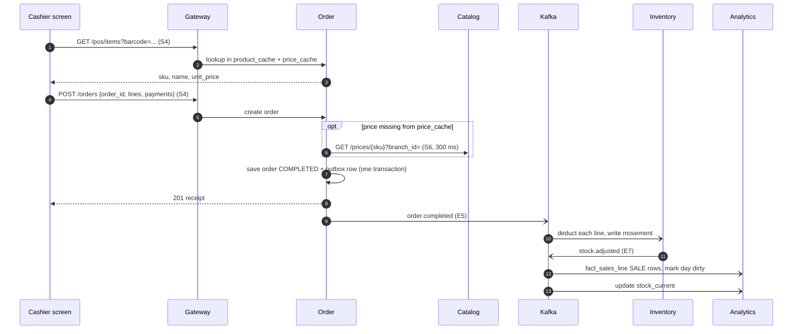

If the browser retries `POST /orders` with the same `order_id`, Order returns the stored order instead of creating a second one.

### 7.2 Nightly reorder and approval

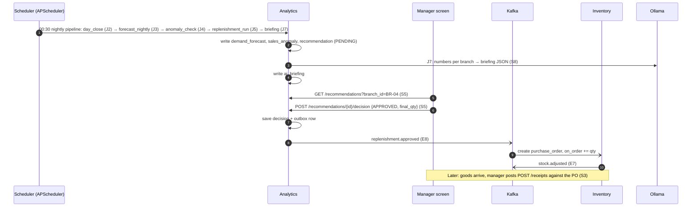

In the demo, HQ starts the same pipeline with `POST /jobs/nightly/run` instead of waiting for 00:30.

---

## 8. Data pipeline and aggregation

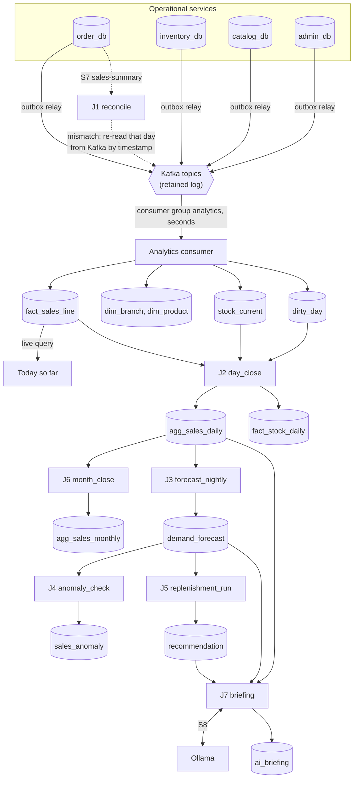

### 8.1 Approaches compared

| Criterion | REST pull | Event-driven | Scheduled batch |
|---|---|---|---|
| How | Analytics calls Order's API for sales | Services publish events; Analytics consumes | A job extracts and aggregates at fixed times |
| Freshness | Last poll | Seconds | Next run |
| Load on the till's database | High: every report hits Order | One outbox row per sale | Spike during extract |
| Coupling | Reports break when Order is down | Loose: consumer catches up later | Loose, but timing-dependent |
| Late or duplicate data | Missed updates are lost | Idempotent upserts; late events still land | Recompute the window |
| Heavy computation | Poor fit | Poor fit on its own | Good fit |

**Selected: events for ingestion, scheduled batch for aggregation and forecasting, REST only to serve results**, plus one REST reconciliation call per night to detect missing events.

- **Events** bring each sale into Analytics within seconds without querying `order_db`. "Today so far" is a live query on `fact_sales_line`. Kafka keeps the log, so Analytics can also re-read any past day, or rebuild its tables from scratch, without asking Order for data.
- **Batch** is used where a complete day is needed: daily and monthly rollups, forecasts and reorder suggestions.
- **REST** serves finished results to the web app.

### 8.2 Jobs (APScheduler, Analytics only)

| Job | Schedule | What it does |
|---|---|---|
| J1 `reconcile` | Daily 00:15 | Compare yesterday's `order_count` and `total_amount` per branch with Order's `/internal/sales-summary` (S7). On a mismatch, start a temporary consumer (its own group id, so the main group's offsets are untouched) on `order.completed` and `order.refunded`. Use `offsets_for_times` to seek to the start of that day, minus a 1-hour margin. Re-apply every event through the normal handler; idempotency skips the ones already stored. Log the result. Nothing is sent to Inventory. |
| J2 `day_close` | Daily 00:30 | Recompute `agg_sales_daily` for **every day in `dirty_day`** (always including yesterday), then clear those markers. Write `fact_stock_daily` for yesterday from `stock_current`. Mark days older than 3 days `FINAL`. |
| J6 `month_close` | 4th of each month, 02:00, and whenever a dirty day falls in a closed month | Sum the month's daily rows into `agg_sales_monthly`. Mark it `FINAL` if all its days are final. |
| J3 `forecast_nightly` | Runs right after J2 succeeds, in the same nightly pipeline | Build a 14-day forecast per branch and SKU. Score yesterday's forecast against actuals and store `wape`. |
| J4 `anomaly_check` | After J3 | Flag branch + SKU pairs selling below `units_low` for 2 days in a row. |
| J5 `replenishment_run` | After J4 | Expire yesterday's unanswered recommendations. Compute new ones per branch. |
| J7 `briefing` | After J5 | For each open branch and for the company: gather yesterday's numbers, call the LLM (S8), validate the answer, and store it in `ai_briefing`. Then pre-generate "Why?" explanations for the new recommendations into `ai_explanation`. Falls back to a template if the LLM fails. See [9.4](#94-llm-briefings-and-explanations). |

The nightly pipeline is one function, `run_nightly()`, that calls J2 → J3 → J4 → J5 → J7 in order and stops at the first failure (the J3 fallback rule in [11.2](#112-when-a-component-is-down) still applies). J7 runs last, so an LLM problem can never block reports, forecasts or recommendations. Each run is logged in a `job_run (run_id, job, started_at, finished_at, status, message)` table.

**On demand.** `POST /jobs/{job}/run` (HQ only; `job` is one of `reconcile`, `day_close`, `month_close`, `forecast`, `replenishment`, `briefing`, `nightly`) runs a job immediately, and `GET /jobs/runs` shows recent runs. The HQ dashboard has a "Run now" button. The demo needs this, because nobody can wait until 00:30.

**Late data.** Every fact insert marks its `(branch_id, sale_date)` dirty, so a sale that arrives a week late still updates the right day and its month. `FINAL` only means "past the usual late window". A final day can still be restated, and restated days are logged.

**Duplicates.** `processed_event` stops a redelivered event. `fact_sales_line` is keyed by `(order_id, line_no, entry_type)` and written with `INSERT … ON CONFLICT DO NOTHING`, so even an event re-read by J1 cannot double-count.

---

## 9. Reporting and forecasting

### 9.1 Questions from the brief

| Question | Answer |
|---|---|
| Where is historical data collected? | `fact_sales_line` and `fact_stock_daily` in `analytics_db`, fed by events. For the demo, a seed generator creates 6 months of sales history and bulk-loads it, so forecasting has history on day one (see [section 12](#12-deployment)). In a real migration the same loader would read the old Django database. |
| How are daily and monthly reports generated? | Daily: J2 at 00:30 rebuilds `agg_sales_daily` for dirty days. Monthly: J6 sums final daily rows on the 4th. Days 1–3 of a month show the previous month as `PROVISIONAL`. |
| Cross-branch comparison | `GET /reports/branches/compare?month=`: revenue, units, orders, average basket, growth vs the same month last year, stockout days. A `GROUP BY branch_id` over the same tables; no extra table. |
| Company-wide | `scope=company`: the same tables summed over all branches, so it always matches the branch reports. |
| When do forecasts run? | Nightly, in the same pipeline right after day close (starts 00:30), or on demand from the HQ "Run now" button. No retraining pipeline; the model is refit on each run. |
| Where are predictions stored? | `demand_forecast` (keyed by run, branch, SKU and date, with low, mid and high values) and `forecast_run`. Recommendations go to `recommendation`. |
| How do managers retrieve results? | Through the web app via the gateway (S5). A branch manager sees only the branches in their token; HQ sees all. A banner on the morning dashboard: "BR-04: 12 reorder suggestions, 2 sales alerts", and above it an AI briefing written by the local LLM from the night's numbers ([9.4](#94-llm-briefings-and-explanations)). CSV export for HQ. |

### 9.2 Forecast method

Keep it explainable:

1. **SKU with at least 8 weeks of history:** Holt-Winters exponential smoothing with weekly seasonality (statsmodels), on daily units.
2. **SKU with 2–8 weeks of history:** the average of the same weekday over the last 4 weeks.
3. **New SKU or new branch:** the category average per SKU at branches in the same region.

`units_mid` is the forecast. `units_low` and `units_high` are `mid ± 1.28 × σ`, where σ is the standard deviation of the last 28 days of forecast errors (an 80% band). Holidays from `calendar` are added as a multiplier learned from last year.

Report `wape = Σ|actual − forecast| / Σ actual` per run, and show it next to a "same weekday last week" baseline so the team can show the forecast is better than guessing.

### 9.3 From forecast to reorder quantity

```
D      = Σ units_mid over the next (lead_time_days + review_days) days
safety = z × σ × √(lead_time_days + review_days)       z = 1.65 for service_level 0.95
target = D + safety
need   = target − on_hand − on_order
qty    = 0 if need ≤ 0, else max(min_order_qty, round_up_to_pack(need))
```

**Transfers before reorders:** if another branch's `on_hand` exceeds its own `target × 2`, suggest a TRANSFER of the surplus (up to `need`) instead of a REORDER.

Each recommendation stores a human-readable `reason`. Managers approve, edit or reject. Decisions are kept, so the team can report how often suggestions were accepted.

### 9.4 LLM briefings and explanations

**Rule: the LLM explains numbers, it never produces them.** Totals, forecasts and reorder quantities all come from the code above. The LLM receives those finished numbers and turns them into text for managers. A wrong sentence can't change a stock level, a report or an order.

| Feature | When | Input sent to the LLM | Output | Shown where |
|---|---|---|---|---|
| **Morning briefing** | J7, nightly or "Run now" | Per branch: yesterday's revenue, units and orders vs forecast and vs the same weekday last week; top 5 SKUs up and down; SKUs at stockout risk (days of cover < lead time); number of pending recommendations; open anomalies; latest WAPE | `{headline, highlights[3], risks[≤3], actions[≤3]}` | Card at the top of the branch dashboard; a company version on the HQ dashboard |
| **"Why?" on a recommendation** | Pre-generated by J7 for every new `PENDING` recommendation; generated on click only if missing. Stored in `ai_explanation` | The recommendation's numbers: forecast demand over lead time, safety stock, on hand, on order, pack size, min order, supplier lead time | `{text}`: 2–3 plain sentences | Expandable row on the reorder suggestions screen |

**Prompting.** The system prompt says: use only numbers from the input JSON, don't invent figures, be short, write in English. The input is passed as JSON. Each prompt has a `prompt_version` stored with its output, so wording changes can be compared. Temperature is 0.2 for stable wording.

**Validation.** The reply must parse against the JSON schema. A light check also compares every number in the text with the numbers in `input_json`. If either check fails, J7 retries once. If it fails again, it stores a **template briefing** built in code, for example "Revenue $1,240 (−8% vs forecast). 3 SKUs at stockout risk. 12 reorder suggestions waiting.", with `status = FALLBACK`. The dashboard labels these, so a manager always knows whether the text came from the LLM.

**Performance.** A 12B model can take a minute or more per call on a laptop without a GPU. Briefings are therefore always **generated ahead of time**, and a page only reads `ai_briefing`. "Why?" explanations are generated by J7 too, so clicking the button is instant. To keep the run short, J7 explains at most 20 recommendations per branch, largest quantity first; any others are generated on click. Before the demo, run `POST /jobs/briefing/run` so everything is ready.

**Model choice.** The default is `gemma4:12b`, which is already installed on the demo laptop. Teammates with less RAM or no GPU can use a smaller model such as `llama3.2:3b`. The model is set with `OLLAMA_MODEL`, and the model name is stored with every output.

**Optional extension: "Ask your data"** (not in the build plan). A chat box where a manager asks a question, and the LLM picks one of the existing report endpoints with parameters through Ollama tool calling. It would never write SQL. Only if time allows.

---

## 10. Front end

One React app. After login, the app reads `roles` from the JWT and shows only the matching menus. A user with several roles, such as a manager who also works the till, can switch between them.

| Area | Role | Screens | APIs |
|---|---|---|---|
| **HQ** | `HQ_ADMIN` | Branches (list, create, close) · Users & role grants · Products, SKUs & prices · Suppliers · Company dashboard with the company AI briefing · Branch comparison · Stock policies · Jobs ("Run now", run history) | Admin, Catalog, Analytics |
| **Branch** | `BRANCH_MANAGER` | Branch dashboard (AI morning briefing card, today so far, daily and monthly) · Stock (search, low stock, negative stock, movement history) · Purchase orders & goods receipt · Transfers · Forecast vs actual chart · Sales alerts · Reorder suggestions (approve, edit, reject, "Why?" explanation) · Sales history & refunds | Inventory, Analytics, Order |
| **POS** | `CASHIER`, `BRANCH_MANAGER` | Sell screen (scan or search → cart → payment → receipt) · Today's sales for this till | Order only |

The POS screen calls only Order, so a cashier can keep selling if Catalog, Inventory or Analytics is down.

---

## 11. Failure handling and design rationale

### 11.1 What must be immediate, what can be asynchronous

| Immediate (REST) | Asynchronous (events) | Scheduled |
|---|---|---|
| Login, POS item lookup, completing a sale, refunds, stock lookups, receipts, approving a reorder, reading reports | Stock deduction after a sale, reference-data copies, facts into Analytics, approved reorder into Inventory | Daily and monthly rollups, forecasts, anomalies, reorder suggestions, reconciliation |

A sale must answer the cashier immediately. Updating stock and reports a few seconds later has no business cost.

### 11.2 When a component is down

| Down | Effect | Recovery |
|---|---|---|
| **Inventory** | POS sales continue. Stock, receipt and transfer screens show an error. | `order.completed` events stay in Kafka. On restart the `inventory` consumer group resumes from its last committed offset and applies them. |
| **Catalog** | POS sales continue from `product_cache` and `price_cache`. Only a SKU never seen before fails ("price unavailable"). HQ cannot edit products. | Nothing to replay; Catalog publishes from its outbox when back. |
| **Analytics** | Tills and stock unaffected. Dashboards, forecasts and suggestions unavailable. | Events stay in Kafka. On restart the `analytics` consumer group catches up from its committed offset, marks days dirty, and the next J2 fixes the rollups. |
| **Forecast job fails** | J3 retries 3 times. If it still fails, J5 uses the previous run if it is at most 2 days old. Otherwise it uses a fallback rule (28-day average demand) and labels suggestions "fallback". | The failed run is marked `FAILED`, visible on the HQ dashboard. |
| **Ollama (LLM)** | Briefing cards show the template text, labelled "Automatic summary". "Why?" shows the recommendation's `reason` field. Reports, forecasts, recommendations and approvals are unaffected, because J7 runs last and nothing depends on it. | Run `POST /jobs/briefing/run` once Ollama is back. |
| **LLM returns bad JSON or wrong numbers** | Schema or number check fails → one retry → template briefing, `status = FALLBACK`. | Look at `input_json` and `output_json` in `ai_briefing`, adjust the prompt, and bump `prompt_version`. |
| **Admin** | New logins fail. Already logged-in users keep working until their token expires, because services verify tokens with a cached public key. | None needed. |
| **Kafka** | Business writes continue. Events pile up in each service's `outbox`. Stock and reports stop updating. | The relay retries and publishes in order when the broker is back; consumers resume from their committed offsets. |
| **A consumer keeps failing on one event** | That event goes to `<topic>.dlq` after 3 attempts, so it doesn't block the partition. | Fix the bug, then re-publish the DLQ message to its source topic. Idempotency makes this safe. |
| **Order** | POS cannot sell. This is the one critical service. | Run 2 replicas behind the gateway. A retry with the same `order_id` is safe. |

### 11.3 Missing, delayed or duplicate events

| Problem | Protection |
|---|---|
| Lost before publishing | Transactional outbox: the event is saved with the business change. |
| Lost after publishing | Producer uses `acks=all` and idempotence. Kafka retains the log, and consumers commit offsets only after their DB transaction, so a crash means redelivery, not loss. Failed events go to `<topic>.dlq`. Nightly J1 compares with Order's totals and re-reads the day from Kafka on a mismatch. |
| Delayed | `dirty_day` marks the affected day; the next J2 recomputes it whatever its age. |
| Duplicate | `processed_event` primary key; natural-key upserts in `fact_sales_line`; `UNIQUE` on `stock_movement` and on `purchase_order.recommendation_id`. |
| Out of order | Message keys keep one order's events, and one branch-SKU's stock changes, in a single partition. `stock.adjusted` also carries `version`, so older snapshots are ignored. Facts are keyed upserts, so arrival order doesn't matter. |
| Consumer started late or wiped | Consumers start from `earliest`. Compacted reference topics rebuild every local copy. |

### 11.4 Real-time, nightly or monthly

| Data | When | Why |
|---|---|---|
| Today-so-far sales, current stock | Real time (seconds) | Managers act on them during the day |
| Daily sales and closing stock per SKU | Nightly 00:30 | Needs the whole day; feeds the forecast |
| Forecasts, anomalies, reorder suggestions | Nightly after day close | Needs a final day; ready before branches open |
| Monthly totals | 4th of the month | Waits out late refunds and late events |

### 11.5 Consistency, scalability and trade-offs

- **Consistency.** Strong inside each service (one PostgreSQL transaction per change, including its outbox row). Eventual between services, usually within seconds. Accepted trade-off: stock can briefly lag sales, and can go negative when the physical count is wrong.
- **Scalability.** Order and Inventory are stateless behind the gateway and can run several replicas. Analytics jobs run off-hours and never touch operational databases, so month-end reports cannot slow the tills.
- **Trade-offs.**
  - Kafka instead of RabbitMQ: a heavier container (about 1 GB RAM), no built-in dead-letter queue (we write `.dlq` topics ourselves), and offset handling needs care. In return, the retained log gives replay, catch-up for late consumers and cache rebuilds with no extra endpoints. A single broker with replication factor 1 is not fault tolerant; production would run 3 brokers.
  - No schema registry: events are JSON with an `event_version` in the envelope. Consumers ignore unknown fields, so adding a field is never a breaking change.
  - APScheduler instead of Airflow or Celery: no DAG UI or distributed workers, but the nightly pipeline is a single sequence of jobs on one service, and `job_run` gives the run history.
  - PostgreSQL instead of ClickHouse: fine at this scale; the star schema can move to a columnar store later unchanged.
  - Merged Admin and Analytics services: fewer moving parts, at the cost of coarser deployment. The internal module boundaries match the full design, so splitting later is mechanical.
  - Statistical forecast instead of ML: less accurate on complex patterns, but explainable and needs no training pipeline.
  - Local LLM (Ollama) instead of a cloud API: free, works offline, and no business data leaves the machine. In return it is slower and less capable than a hosted model. That is acceptable because it only writes short summaries, ahead of time, from numbers we already computed. Keeping the LLM out of every decision path means a wrong or missing answer can't corrupt data.

---

## 12. Deployment

`docker compose up` starts:

| Container | Image / command | Port |
|---|---|---|
| `web` | React build served by Nginx | internal |
| `gateway` | Nginx: `/` → web, `/api/<service>/<path>` → `<service>:8000/<path>` for admin, catalog, inventory, order and analytics (prefix stripped) | **8080 (only public port)** |
| `admin`, `catalog`, `inventory`, `order`, `analytics` | Each service's image, `gunicorn` | internal |
| `admin-relay`, `catalog-relay`, `inventory-worker`, `order-worker`, `analytics-worker` | Same image as the service, command `manage.py run_worker`: outbox relay, plus the Kafka consumer for services that consume | — |
| `analytics-scheduler` | Analytics image, `manage.py run_scheduler` (APScheduler) | — |
| `postgres` | PostgreSQL 16. The init script creates 5 databases and 5 users, and revokes `CONNECT` from `PUBLIC` | internal |
| `kafka` | `apache/kafka` 4.x, single broker in KRaft mode, heap capped at 512 MB | internal |
| `kafka-init` | Runs once: creates every topic in [6.4](#64-kafka-topics-and-consumer-groups) with its key, partitions and cleanup policy, then exits. Services wait for it to finish. | — |
| `kafka-ui` | Web UI for topics, messages, consumer-group lag and DLQs | 8081 (dev and demo) |

**Ollama is not in Compose.** It runs on the host machine (installed natively, so it can use the GPU if there is one). Analytics reaches it at `OLLAMA_URL`, default `http://host.docker.internal:11434`. The demo laptop already has `gemma4:12b`; check it with `ollama list` before the demo. Teammates without Ollama set `LLM_PROVIDER=fake`.

**Seed data** (`docker compose run --rm seed`), in two parts:

1. **Reference data through the real APIs:** 1 shop, 5 branches, about 200 SKUs in 10 categories, prices, 3 suppliers with terms, default stock policies, and users for every role. These go through the services, so the events reach every local copy the normal way.
2. **History through a bulk loader:** a generator creates 6 months of sales (about 90,000 orders, with weekday patterns and some trend). They are bulk-inserted into `order_db` and `fact_sales_line` directly, not sent through Kafka, because publishing that many events would be slow and adds nothing to the demo. The loader then sets realistic `stock_level` rows in Inventory and runs J2 and J6 over the whole history. This is described in the presentation as the "historical import" from the old system.

Generated history never touches the live topics, so J1 only reconciles days after the seed date.

Observability (minimum): each request gets an `X-Request-ID` at the gateway, which is passed on and logged by every service and copied into events as `correlation_id`. `GET /health` on every service.

---

## 13. Team split and build order

### 13.1 Team split

| Member | Owns |
|---|---|
| **M1** | Front end: all three role areas, auth handling, charts |
| **M2** | `retail-common` library (JWT, outbox relay, Kafka consumer, DLQ), gateway, Docker Compose, Kafka topics (`kafka-init`), **Admin** and **Catalog** services, reference seed data |
| **M3** | **Order** and **Inventory** services and the events between them |
| **M4** | **Analytics**: consumer, star schema, jobs J1–J7 and the scheduler, forecast and reorder logic, history generator and bulk loader, Ollama client and prompts. M1 builds the briefing card and the "Why?" button. |

**Build order** (each step is demoable):

1. **Skeleton.** Compose file with Postgres, Kafka, `kafka-init` and `kafka-ui`; 5 empty services with `/health`; gateway routing; shared library; login with JWT. M1 builds the app shell and the login screen.
2. **Reference data.** Admin branches and users, Catalog products and prices, events E1–E4 landing in every copy table.
3. **Selling.** POS screen → Order → `order.completed` → Inventory deducts stock. Refunds.
4. **Stock operations.** Adjustments, ad hoc receipts, stock screens.
5. **Reporting.** Facts, J2 and J6, daily, monthly, comparison and company dashboards. History generator and bulk loader.
6. **AI.** J3 forecast, J5 recommendations, approval → E8 → purchase order → receipt. "Run now" job endpoints. Then J7 LLM briefing and "Why?" explanations (fake provider first, then Ollama).
7. **Hardening.** J1 reconciliation, failure demos (stop Inventory during a sale, then restart it), README and presentation.

Steps 2–4 and 5 can run in parallel once step 1 is done, because M4 can work from generated events before Order is finished.

### 13.2 Demo priority

The deadline is **4 December 2026**. Everything in this document stays as the design, but the build is prioritised as follows.

| Priority | Items |
|---|---|
| **Must work live** | Login with role-based menus · POS sale and whole-order refund · stock deducted through `order.completed` · stock screen with movement history · daily, monthly, cross-branch and company reports · forecast vs actual chart · reorder suggestion → approve → purchase order → goods receipt · J1 reconciliation · "Run now" job buttons · failure demo: stop Inventory, sell, restart, stock catches up (consumer lag visible in `kafka-ui`) · cross-database access refused by Postgres |
| **Build next, once the must-work items run (about Nov 30)** | J7 LLM morning briefing card (branch and company) · "Why?" explanation on recommendations · template fallback when Ollama is stopped (show this live as a failure demo) |
| **Seeded, minimal or no UI** | Suppliers and supplier terms, stock policies, most user and branch admin (only a branch list and a create form) |
| **Deferred: in the design, built only if time allows** | Inter-branch transfers and TRANSFER recommendations · J4 anomaly check and the sales alerts screen · CSV export · switching between several roles · holiday multiplier and the region-average forecast fallback · "Ask your data" LLM chat |

Deferred items are still presented as part of the architecture. The slides say which parts are built.

### 13.3 Timeline

| Dates | Goal |
|---|---|
| Nov 23–24 | Build step 1 (skeleton) |
| Nov 25–27 | Steps 2–4 (M2, M3) in parallel with step 5 on generated events (M4) |
| Nov 28–30 | Steps 5–6: seed history, rollups, dashboards, forecast, recommendations → PO → receipt. Nov 30: J7 LLM briefing and "Why?" |
| Dec 1–2 | Step 7: J1, failure demo, bug fixes, a full run on a clean machine |
| Dec 3 | Slides (export the Mermaid diagrams in this document) and rehearsal |
| Dec 4 | Submission, presentation and live demo |

---

## 14. Changes from the architecture review

Review of 2026-11-22. All changes are already applied in the sections above.

| # | Change | Reason |
|---|---|---|
| 1 | **Kafka replaces RabbitMQ** (single KRaft broker, one topic per event type, compacted reference topics) | The retained log removes three workarounds: events lost before a queue existed, Order's `/internal/replay` endpoint, and a resync job to rebuild caches. It also matches the full target architecture. |
| 2 | **APScheduler replaces Celery + beat** | With Kafka, Celery would need a broker of its own. The nightly jobs are one sequence on one service. |
| 3 | **`REVOKE CONNECT ... FROM PUBLIC`** in the Postgres init script | Postgres lets any user connect to any database by default, so "one user per service" alone did not enforce isolation. |
| 4 | **J1 re-reads the day from Kafka** with a temporary consumer group instead of asking Order to replay | The old replay would have re-sent sales to Inventory too. Now only Analytics re-reads, and Order no longer needs a replay endpoint. |
| 5 | **"Run now" job endpoints** (`POST /jobs/{job}/run`) and a `job_run` table | The demo cannot wait until 00:30 for reports and forecasts. |
| 6 | **Seed history through a bulk loader**, reference data through the real APIs | There is no old Django database to import. Sending about 90,000 historical orders through Kafka would be slow. |
| 7 | **DLQ simplified** to 3 attempts, then `<topic>.dlq` | Kafka has no built-in dead-letter queue. A simple rule written once in `retail-common` is enough. |
| 8 | **Mantine + TanStack Query** added to the front end; **public key from an env var** instead of JWKS; **one monorepo** | Saves time with no architectural cost. |
| 9 | **Demo priority and timeline** (13.2, 13.3) | 12 days remain, and nothing is built yet. |
| 10 | **LLM insights via local Ollama** (added after the review): J7 briefing, "Why?" explanations, S8, `ai_briefing` and `ai_explanation` tables, template fallback | Adds a visible generative-AI feature to Task 5. The LLM only narrates computed numbers, so it can't corrupt data, and it is never on a critical path. |
