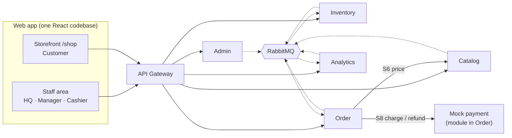
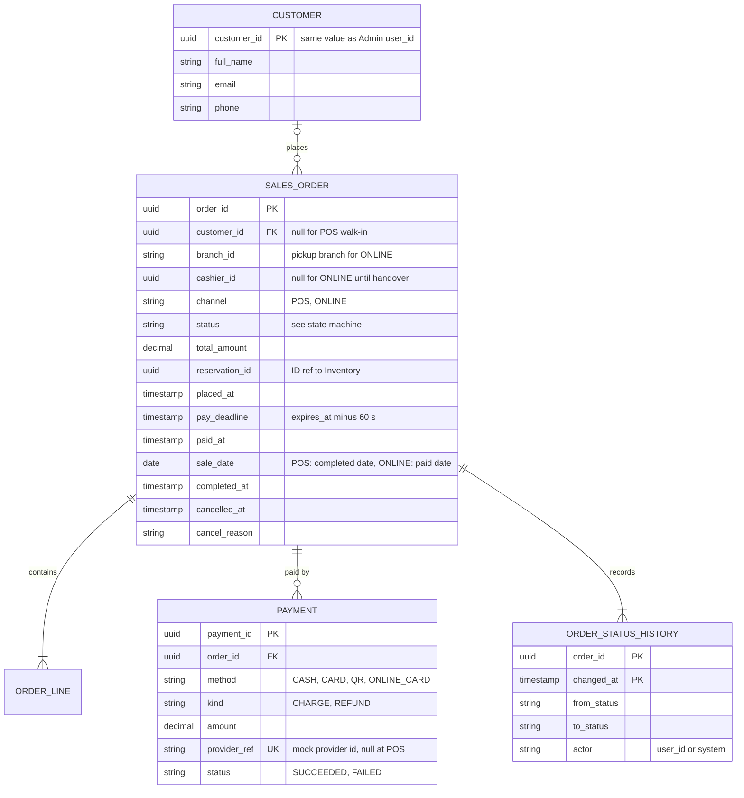
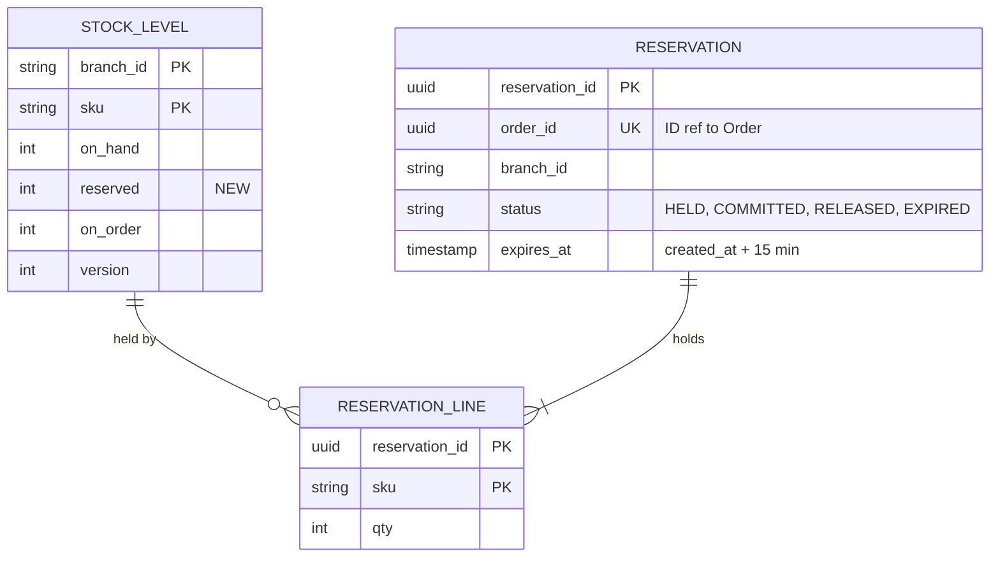
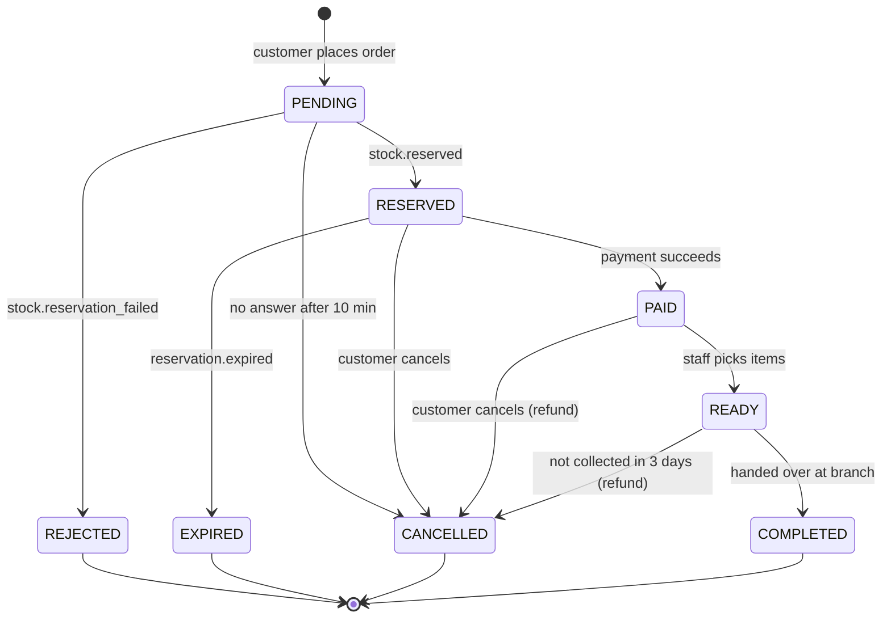
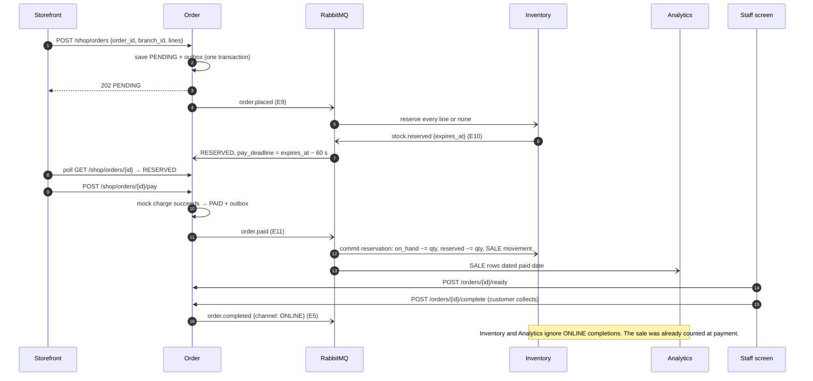

# Option B: staff app plus customer storefront

> **Status (2026-11-22): deferred.** The team is building [Option A](option-a-staff-app.md), which now uses Kafka instead of RabbitMQ. Read every "queue" below as a Kafka consumer group subscribed to the same events.

**Option B = everything in [Option A](option-a-staff-app.md) + an online click-and-collect storefront.** This document only describes what is added or changed. Anything not mentioned here works exactly as in Option A.

- [1. Added scope](#1-added-scope)
- [2. Architecture changes](#2-architecture-changes)
- [3. Service changes](#3-service-changes)
- [4. Database changes](#4-database-changes)
- [5. Online order lifecycle](#5-online-order-lifecycle)
- [6. Communication matrix additions](#6-communication-matrix-additions)
- [7. Reporting changes](#7-reporting-changes)
- [8. Front end additions](#8-front-end-additions)
- [9. Failure handling additions](#9-failure-handling-additions)
- [10. Team split and build order](#10-team-split-and-build-order)

---

## 1. Added scope

**In scope**

- Customers sign up and log in.
- Customers browse products, prices and in-stock status for a chosen branch.
- Customers place an online order for **pickup at one branch** (click-and-collect).
- Stock is **reserved** when the order is placed and held for 15 minutes until payment.
- Payment goes through a **mock payment provider** inside Order: a "Pay" button that succeeds, or fails when the card number ends in `0000`, for the demo.
- Customers track and cancel their orders. Cancelling after payment refunds in full.
- Branch staff see a pickup queue, mark orders ready, and hand them over.

**Still out of scope:** home delivery, a real payment gateway, partial fulfilment (the whole order is reserved or the order is rejected), promotions, product reviews.

**Why click-and-collect only:** delivery adds addresses, couriers and delivery slots, and none of that exercises the architecture further. Pickup at a branch reuses the branch stock and staff that Option A already has.

---

## 2. Architecture changes

Still **5 services, 1 web app, 1 broker**. No new service is needed:

| Change | Where |
|---|---|
| Public routes `/shop/*` in the same React app | Front end |
| New role `CUSTOMER`, self sign-up | Admin |
| Customers, online orders, order state machine, mock payment | Order |
| Reservations with expiry, public availability endpoint | Inventory |
| Online sales counted at payment, channel split in reports | Analytics |
| Anonymous read routes and a tighter rate limit for `/api/shop/*` | Gateway |

**Public (no login):** `GET /api/shop/products`, `GET /api/shop/availability`, `GET /api/shop/branches`, `POST /api/admin/auth/register`.
**Customer login required:** placing, paying, cancelling and listing your own orders.

---

## 3. Service changes

### Admin

- New role `CUSTOMER`, granted with `branch_id = null` at sign-up.
- New endpoint `POST /auth/register {email, password, full_name, phone}` → `{user_id, access_token}`.
- New endpoint `GET /shop/branches`: public list of open branches (`branch_id, name, address`).
- **Publishes** `customer.registered`.

### Catalog

- New endpoint `GET /shop/products?branch_id=&q=&category_id=`: active products with the branch's current price. A public read model of data Catalog already has.

### Inventory

- `stock_level` gets a `reserved` column. **Available = `on_hand − reserved`.**
- New tables `reservation` and `reservation_line`.
- New endpoint `GET /shop/availability?branch_id=&skus=` → `[{sku, in_stock}]`. Shows only a yes/no, never exact counts.
- New job (Inventory worker, every minute): expire reservations past `expires_at` and publish `reservation.expired`.
- **Publishes** `stock.reserved`, `stock.reservation_failed`, `reservation.expired`.
- **Consumes** `order.placed`, `order.paid`, `order.cancelled` (in addition to Option A's events).

### Order

- New table `customer`, filled from `customer.registered`. If an order arrives before the event, the customer row is created from the JWT claims (`sub`, `name`), so a customer who orders seconds after signing up is not rejected.
- Online orders follow the state machine in [section 5](#5-online-order-lifecycle).
- Mock payment module behind an interface (`PaymentProvider.charge()`, `.refund()`), so a real provider could replace it.
- New endpoints:

| Endpoint | Who | Purpose |
|---|---|---|
| `POST /shop/orders {order_id, branch_id, lines:[{sku, qty}]}` | Customer | Place an online order → `PENDING` |
| `POST /shop/orders/{id}/pay {card_number}` | Customer | Pay; allowed only in `RESERVED` and before `pay_deadline` |
| `POST /shop/orders/{id}/cancel` | Customer | Cancel; refunds if paid |
| `GET /shop/orders`, `GET /shop/orders/{id}` | Customer | Own orders and status |
| `GET /orders?branch_id=&channel=ONLINE&status=PAID,READY` | Manager, cashier | Pickup queue |
| `POST /orders/{id}/ready`, `POST /orders/{id}/complete` | Manager, cashier | Mark ready; hand over (customer shows the order number) |

- New job (Order worker, every minute): cancel orders stuck in `PENDING` for more than 10 minutes (Inventory didn't answer), and orders `READY` and not collected for 3 days (refunded).
- **Publishes** `order.placed`, `order.paid`, `order.cancelled`. `order.completed` is also sent for online orders, with `channel = ONLINE`.
- **Consumes** `customer.registered`, `stock.reserved`, `stock.reservation_failed`, `reservation.expired`.

### Analytics

- Counts online sales at `order.paid`, not `order.completed`. See [section 7](#7-reporting-changes).
- Adds `channel` filters to reports.

---

## 4. Database changes

Only new or changed tables are shown.

### order_db

`order_line`, `product_cache` and `price_cache` are unchanged. The online price is the pickup branch's price at the time the order is placed, snapshotted in `order_line`.

### inventory_db

A reservation is checked and written in one transaction with `SELECT … FOR UPDATE` on the affected `stock_level` rows. Two customers cannot reserve the last unit. `UNIQUE order_id` makes a redelivered `order.placed` a no-op.

New `stock_movement.reason` value: `RESTOCK`, used when a paid online order is cancelled before pickup and the goods go back on the shelf.

### admin_db

`role_grant.role_code` gains `CUSTOMER`. No other change.

---

## 5. Online order lifecycle

### 5.1 State machine

### 5.2 Happy path

### 5.3 Rules that remove race conditions

| Race | Rule |
|---|---|
| Customer pays just as the reservation expires | Order refuses payment after `pay_deadline`, which is 60 seconds **before** Inventory's `expires_at`. A paid order always has a held reservation. |
| `stock.reserved` arrives after Order already cancelled the order (10-minute timeout) | Order replies with `order.cancelled {was_paid: false}`, and Inventory releases the reservation. |
| Same event delivered twice | `processed_event` in both services; `UNIQUE order_id` on `reservation`. |
| Two customers want the last unit | Row lock on `stock_level` inside the reservation transaction; the second gets `stock.reservation_failed`. |
| Payment succeeds but Order crashes before saving | The mock provider is called with `idempotency_key = order_id`. On retry it returns the existing charge instead of charging again. |

Compared with the full design, this replaces "Inventory treats a late OrderPaid as a new reservation, then refunds if stock is gone" with a simpler rule: **never accept a payment that could outlive its reservation.**

---

## 6. Communication matrix additions

### 6.1 Overview (B additions in bold)

| From ↓ / To → | Admin | Catalog | Inventory | Order | Analytics |
|---|---|---|---|---|---|
| **Gateway** | S1 | S2 | S3 | S4 | S5 |
| **Admin** | | | E1 | **E12** | E1 |
| **Catalog** | | | E2 | E2, E3 | E2, E4 |
| **Inventory** | | | | **E10** | E7 |
| **Order** | | S6 | E5, E6, **E9, E11, E13** | | E5, E6, **E11, E13** |
| **Analytics** | | | E8 | S7 | |

S8 (Order → mock payment) stays inside Order and is shown for completeness.

### 6.2 Added synchronous calls

| ID | From → To | Request → response fields | Trigger |
|---|---|---|---|
| S1+ | Gateway → Admin | `POST /auth/register {email, password, full_name, phone}` → `{user_id, access_token}` | Customer signs up |
| S2+ | Gateway → Catalog | `GET /shop/products?branch_id=&q=` → `[{sku, name, brand, category, unit_price}]` | Customer browses |
| S3+ | Gateway → Inventory | `GET /shop/availability?branch_id=&skus=` → `[{sku, in_stock}]` | Product list or cart opens |
| S4+ | Gateway → Order | `POST /shop/orders {order_id, branch_id, lines:[{sku, qty}]}` → `{order_id, status: PENDING}`. `POST /shop/orders/{id}/pay {card_number}` → `{status, payment_id}`. `POST /orders/{id}/ready`, `/complete` | Checkout, payment, pickup |
| S8 | Order → mock payment | `charge {idempotency_key: order_id, amount, card_number}` → `{provider_ref, status}`. `refund {provider_ref, amount}` | Pay, or cancel after payment |

### 6.3 Added and changed events

| ID | Event | From → To | Payload fields | Trigger | Consumer action |
|---|---|---|---|---|---|
| E5 (changed) | `order.completed` | Order → Inventory, Analytics | Option A fields; `channel` is now `POS` or `ONLINE` | POS sale saved, or online order handed over | `POS`: as in Option A. `ONLINE`: ignored (already counted at payment). |
| E6 (unchanged) | `order.refunded` | Order → Inventory, Analytics | Option A fields | POS refund only | As in Option A |
| E9 | `order.placed` | Order → Inventory | `order_id, branch_id, channel: ONLINE, customer_id, placed_at, lines:[{line_no, sku, qty}]` | Customer places an online order | Reserve all lines or none |
| E10 | `stock.reserved` | Inventory → Order | `order_id, reservation_id, branch_id, expires_at` | Reservation succeeded | `PENDING → RESERVED`, set `pay_deadline` |
| E10 | `stock.reservation_failed` | Inventory → Order | `order_id, branch_id, missing:[{sku, requested, available}]` | Not enough stock for some line | `PENDING → REJECTED` |
| E10 | `reservation.expired` | Inventory → Order | `order_id, reservation_id, expired_at` | Unpaid past `expires_at` | `RESERVED → EXPIRED`; ignored if already `PAID` (cannot happen under the pay-deadline rule) |
| E11 | `order.paid` | Order → Inventory, Analytics | `order_id, branch_id, channel: ONLINE, customer_id, paid_at, sale_date, total_amount, payment_id, lines:[{line_no, sku, qty, unit_price, line_total}]` | Mock charge succeeded | Inventory: commit reservation, SALE movements. Analytics: SALE rows dated `sale_date`. |
| E12 | `customer.registered` | Admin → Order | `user_id, full_name, email, phone, registered_at` | Customer signs up | Upsert `customer` |
| E13 | `order.cancelled` | Order → Inventory, Analytics | `order_id, branch_id, channel, was_paid, from_status, cancelled_at, refund_date, reason, lines:[{line_no, sku, qty, line_total}]` | Customer or system cancels | Inventory: release a `HELD` reservation; if `was_paid`, RESTOCK movements (+qty). Analytics: if `was_paid`, REFUND rows dated `refund_date`. |

**Queue bindings added:** `inventory.events` += `order.placed`, `order.paid`, `order.cancelled`. `order.events` += `customer.registered`, `stock.reserved`, `stock.reservation_failed`, `reservation.expired`. `analytics.events` += `order.paid`, `order.cancelled`.

---

## 7. Reporting changes

**When a sale counts:**

| Channel | SALE counted at | REFUND counted at |
|---|---|---|
| POS | `order.completed`, dated `sale_date` | `order.refunded`, dated `refund_date` |
| ONLINE | `order.paid`, dated `sale_date` (= paid date) | `order.cancelled` with `was_paid = true`, dated `refund_date` |

Each sale has exactly one recognition event, so it can never move to a different day. Unpaid online orders (rejected, expired, cancelled before payment) never reach the sales facts.

**Schema:** `agg_sales_daily` gets `channel` as an extra key column. `agg_sales_monthly` gets `pos_revenue` and `online_revenue`.

**New report numbers:** online share of revenue per branch, online conversion (`PAID ÷ PLACED`), reservation failure rate (a signal of stock problems), and average time from paid to collected.

**Reconciliation (J1):** Order's `/internal/sales-summary` returns totals per branch **and channel**, using the same recognition rules.

**Forecasting:** demand is forecast on total units across both channels, because both draw on the same branch stock. Reservations that fail with `stock.reservation_failed` are logged as **lost demand** in a new `fact_lost_demand (branch_id, sku, date, qty)` table. Forecasting adds it to actual sales so stockouts don't train the model to expect low demand.

---

## 8. Front end additions

The storefront lives in the same React app under `/shop`, with its own simple layout. It shares the API client, auth handling and component library with the staff area.

| Screen | Route | Login |
|---|---|---|
| Choose pickup branch | `/shop` | No |
| Product list (search, category, in-stock badge) | `/shop/products` | No |
| Product detail | `/shop/products/:sku` | No |
| Cart (kept in local state) | `/shop/cart` | No |
| Sign up / log in | `/shop/login` | — |
| Checkout: place → "confirming stock" spinner → pay with 15-minute countdown | `/shop/checkout` | Yes |
| My orders and status | `/shop/orders` | Yes |

**Staff additions:** a **Pickup queue** page in the Branch area (online orders `PAID` and `READY` for this branch, with buttons for ready and complete), and a channel filter on dashboards.

---

## 9. Failure handling additions

| Down | Effect on online orders | Recovery |
|---|---|---|
| **Inventory** | New orders stay `PENDING` ("confirming stock"). The in-stock badge is hidden. POS is still unaffected. | After 10 minutes Order cancels them. If Inventory reserves later, Order sends `order.cancelled` and the stock is released. |
| **Mock payment** | Pay fails; the order stays `RESERVED`. The customer can retry until `pay_deadline`. | Expires normally if not paid. |
| **Order** | Storefront and POS both stop. Still the one critical service. | 2 replicas; idempotent `order_id` makes retries safe. |
| **Catalog** | Storefront product list unavailable. POS keeps selling from caches. | — |
| **Admin** | No new sign-ups or logins. Logged-in customers keep shopping until their token expires. | — |
| **Analytics** | No effect on ordering. | Catches up from its queue, as in Option A. |
| **Inventory's expiry job stalls** | Reservations stay `HELD` longer, so stock looks unavailable. Customers can't pay anyway after `pay_deadline`. | The job catches up on restart and expires everything overdue. |

**Immediate vs asynchronous, changed for B:** placing an online order returns `202 PENDING` right away and confirms stock asynchronously, because a reservation should not depend on Inventory answering within one HTTP request. Payment is synchronous, because the customer is waiting for the result.

---

## 10. Team split and build order

Option B adds roughly 35–50% to Option A. Most of it lands on M1 (storefront) and M3 (saga), so M2 takes some of their load:

| Member | Option A work | Option B additions |
|---|---|---|
| **M1** | Staff front end | Pickup queue page, channel filters |
| **M2** | Shared library, gateway, Admin, Catalog | **Storefront screens**, registration, `/shop/products`, public gateway routes |
| **M3** | Order, Inventory | State machine, reservations, mock payment, timeout and expiry jobs |
| **M4** | Analytics | Channel split, `order.paid` / `order.cancelled` handling, lost demand |

**Build order:** finish Option A steps 1–6 first. Then:

1. **Customers.** Registration, `CUSTOMER` role, `customer.registered`, storefront browse with prices.
2. **Reservations.** `order.placed` → reserve → `stock.reserved` / `stock.reservation_failed`; expiry job. Test the "last unit" race with two browsers.
3. **Payment and pickup.** Mock pay, `order.paid` commits stock, pickup queue, completion.
4. **Cancellation and reporting.** Cancel at every state, refunds, RESTOCK, channel reports, lost demand.
5. **Failure demo.** Stop Inventory, place an online order, show it waiting in `PENDING`, restart Inventory, show it reserve. Then stop Inventory past the 10-minute timeout and show the cancellation and release.

**Prepare for B while building A:** keep `channel` on `sales_order` and in every order event, keep `status` an enum rather than a boolean, include `CUSTOMER` in the role enum, and route `/api/shop/*` in the gateway from the start. Adding Option B then needs no migration of existing data.
